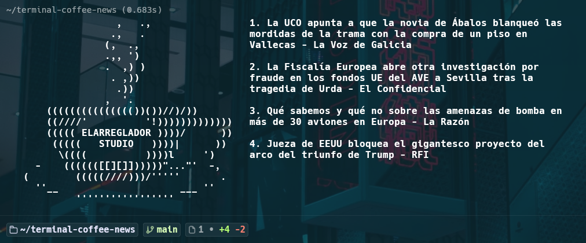

# Terminal Coffee News

Un dashboard minimalista para tu terminal que muestra el arte ASCII de una taza de café junto a las últimas noticias en tiempo real procedentes de Google News (edición España).

Diseñado especialmente para ejecutarse automáticamente cada vez que abres una nueva ventana o pestaña en tu terminal.

## Vista previa



---

## ¿Qué hace este proyecto?

1. **Noticias en tiempo real:** Lee directamente el feed de prensa de Google News sin necesidad de claves de API ni registros.
2. **Diseño en dos columnas:** Coloca un dibujo en formato ASCII a la izquierda (por defecto, una taza de café) y los titulares a la derecha de forma alineada y limpia.
3. **Enlaces interactivos:** Los titulares son desplegables como hipervínculos. Puedes hacer clic en ellos directamente desde la terminal para abrirlos en tu navegador web.

---

## Requisitos y Entorno Recomendado

- **Sistema Operativo:** Linux / macOS.
- **Terminal Recomendada:** [Warp Terminal](https://www.warp.dev/) (permite la interacción directa por clic en los hipervínculos ANSI sin mostrar URLs largas).
- **Intérprete:** Python 3 (incluido de forma nativa en la mayoría de sistemas Linux/macOS). No requiere instalar paquetes externos (`pip`).

---

## Archivos del Repositorio

- **`news.py`**: El script en Python que descarga las noticias, procesa los enlaces y maqueta las columnas.
- **`elArregladorStudio.txt`**: Archivo de texto plano con el dibujo ASCII de la taza de café.

---

## Guía de Instalación Paso a Paso

Sigue estos sencillos pasos desde tu terminal para instalarlo en la carpeta `~/terminal-coffee-news/`.

### 1. Descargar los archivos

Clona el repositorio. Si no tienes configuradas claves SSH, usa la variante HTTPS:

```bash
# Por SSH
git clone git@github.com:elarreglador/terminal-coffee-news.git

# Por HTTPS
git clone https://github.com/elarreglador/terminal-coffee-news.git
```

Esto crea la carpeta `terminal-coffee-news/` en tu directorio actual (recomendado: tu `$HOME`).

### 2. Probar el script manualmente

Entra en la carpeta del repositorio y ejecuta el script:

```bash
cd ~/terminal-coffee-news
python3 news.py
```

Deberías ver la taza de café a la izquierda y 4 titulares actualizados a la derecha.

> Nota: el script descarga los titulares de Google News, por lo que necesita conexión a internet. El dibujo ASCII se lee desde `~/elArregladorStudio.txt` (en tu home), no desde la carpeta del repositorio.

### 3. Configurar la ejecución automática al abrir la terminal

Si quieres que este saludo aparezca automáticamente cada vez que abres tu terminal:

#### En Bash (Linux por defecto):

Abre tu archivo de configuración `~/.bashrc` y añade la siguiente línea al final:

```bash
python3 "$HOME/terminal-coffee-news/news.py"
```

> **Importante:** usa siempre una ruta absoluta basada en `$HOME` (o `~`), nunca rutas relativas como `./...`. Algunas terminales (como Warp) abren con un directorio de trabajo distinto a `$HOME`, lo que rompe las rutas relativas y provoca errores del tipo `python3: can't open file '.../terminal-coffee-news/./terminal-coffee-news/news.py'`. Además, en Bash la tilde `~` no se expande dentro de comillas, por eso se recomienda `$HOME`.

#### En Zsh (por defecto en Warp o macOS):

Abre tu archivo de configuración `~/.zshrc` y añade al final:

```bash
python3 "$HOME/terminal-coffee-news/news.py"
```

> Si tu archivo `~/.zshrc` no existe, créalo primero (`touch ~/.zshrc`) antes de editarlo.

---

## Personalización

- **Cambiar el arte ASCII:** El script lee el dibujo desde `~/elArregladorStudio.txt` (en tu home). Puedes reemplazar su contenido por cualquier otro dibujo en código ASCII manteniendo el mismo nombre de archivo y ubicación. El archivo `elArregladorStudio.txt` incluido en el repositorio es una copia de referencia; cópialo a tu home (`cp ~/terminal-coffee-news/elArregladorStudio.txt ~/elArregladorStudio.txt`) si aún no está ahí.
- **Cantidad de noticias:** Dentro del archivo `news.py`, puedes modificar el número en la línea `[:4]` para mostrar más o menos titulares.

---

Desarrollado para personalizar tu entorno de trabajo diario con un toque limpio y funcional.